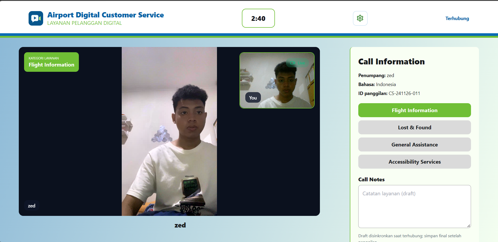
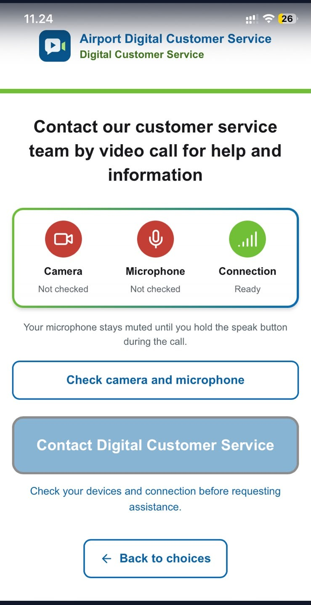

# Airport Digital Customer Service

Sistem bantuan melalui panggilan video di jaringan lokal untuk simulasi layanan pelanggan bandara.

## Gambaran Umum

Airport Digital Customer Service mempertemukan penumpang yang membutuhkan bantuan dengan petugas layanan bandara. Penumpang menggunakan portal di perangkat seluler, sedangkan petugas menangani antrean dan meninjau riwayat panggilan dari Dashboard di laptop.

Setelah dependensi terpasang dan HTTPS lokal dikonfigurasi, aplikasi dapat berjalan tanpa akses internet selama kedua perangkat dapat saling terhubung melalui LAN. WebRTC dapat membangun koneksi langsung melalui jaringan tersebut. Server STUN publik yang dikonfigurasi memerlukan koneksi internet.

## Penafian Proyek Portofolio

Airport Digital Customer Service adalah proyek portofolio independen. Proyek ini tidak berafiliasi dengan perusahaan, bandara, atau operator bandara mana pun dan tidak mewakili layanan resmi mereka. Gunakan nama dan data layanan fiktif saat mendemonstrasikan aplikasi.

Logo dan ikon aplikasi merupakan aset identitas proyek. Tangkapan layar digunakan untuk mendokumentasikan antarmuka. Periksa hak penggunaan dan izin pemilik aset sebelum menggunakan ulang gambar, logo, atau materi pihak lain.

## Fitur Utama

- Panggilan video satu lawan satu melalui WebRTC dengan audio Push-to-Talk.
- Antrean waktu nyata melalui Socket.IO dan tombol **Accept Call** serta **Reject Call** di antarmuka petugas.
- Akses petugas dengan kode yang diverifikasi oleh server serta **Logout / Ganti Petugas** untuk berganti identitas demo.
- Penghitung lama menunggu berdasarkan waktu masuk antrean yang dicatat server. Tampilan diperbarui setiap detik dan durasi tetap dihitung dari waktu yang sama saat petugas berpindah tampilan atau koneksi tersambung kembali.
- Antarmuka penumpang dalam bahasa Indonesia, Inggris, Prancis, Jepang, Arab (kanan ke kiri), dan Mandarin Sederhana.
- Catatan layanan, penilaian penumpang, statistik Dashboard, dan riwayat **Recent Calls** dengan maksimal lima kartu per halaman.
- Nomor referensi permanen berformat `CS-DDMMYY-NNN` dengan tombol **Copy ID**. Nomor urut dimulai ulang setiap hari berdasarkan zona waktu `Asia/Jakarta`.
- Penyimpanan lokal untuk metadata panggilan, catatan, dan penilaian. Aplikasi tidak merekam audio maupun video panggilan.

## Teknologi yang Digunakan

| Bagian | Teknologi |
| --- | --- |
| Antarmuka | React, TypeScript, Vite, Tailwind CSS |
| Backend | Node.js, Express, Socket.IO |
| Media | WebRTC serta API kamera dan mikrofon di peramban |
| Penyimpanan | SQLite melalui `node:sqlite` |
| HTTPS lokal | mkcert dan server pengembangan Vite |

## Arsitektur Sistem

Peramban petugas membuka aplikasi melalui HTTP pada alamat loopback laptop. Peramban penumpang membuka aplikasi melalui HTTPS pada alamat IP LAN laptop. Setiap peramban mengirim permintaan Socket.IO ke origin halaman yang sedang dibuka. Vite meneruskan permintaan tersebut ke backend di `127.0.0.1:3000`.

Socket.IO mengelola antrean dan pertukaran pesan signaling untuk WebRTC. Setelah koneksi WebRTC terjalin, kedua peramban bertukar audio dan video secara langsung. Server menyimpan antrean aktif di memori serta metadata dan hasil layanan di SQLite.

```text
Peramban petugas (HTTP loopback)     Peramban penumpang (HTTPS LAN)
                 |                            |
                 +------ Vite /socket.io -----+
                              |
                     Express + Socket.IO
                       |              |
                Antrean di RAM    SQLite lokal

Peramban petugas <------- media WebRTC -------> Peramban penumpang
```

## Struktur Folder Proyek

```text
src/                 Antarmuka, hook WebRTC, dan kamus bahasa penumpang
public/              Logo proyek dan ikon peramban
server/              Express, antrean Socket.IO, dan penyimpanan SQLite
server/tests/        Tes akses lokal, antrean, riwayat, dan bahasa
screenshots/         Tangkapan layar yang ditinjau untuk galeri
vite.config.ts       HTTP/HTTPS pengembangan dan proksi Socket.IO
.env.example         Templat konfigurasi opsional antarmuka
server/.env.example  Templat konfigurasi backend lokal
```

Dokumentasi Markdown selain `README.md` disimpan secara lokal dan dikecualikan dari publikasi di repositori.

## Persyaratan Perangkat dan Perangkat Lunak

- Node.js 22.20 atau lebih baru pada seri 22, serta npm. Pengujian sebelumnya menggunakan Node.js 22.20.0 dan npm 10.9.3.
- Laptop petugas dan perangkat penumpang dengan peramban yang mendukung WebRTC, kamera, serta mikrofon.
- mkcert untuk membuat sertifikat HTTPS lokal.
- LAN atau hotspot tepercaya yang memungkinkan kedua perangkat saling terhubung.

## Instalasi

Jalankan kedua perintah berikut dari direktori utama proyek.

```sh
npm ci
npm --prefix server ci
```

Frontend dan backend masing-masing memiliki `package-lock.json`. Proyek ini menggunakan npm untuk memasang dependensi. Berkas pengunci dari pengelola paket sebelumnya dikecualikan dari repositori.

## Konfigurasi HTTPS Lokal dengan mkcert

1. Gunakan CA mkcert yang sudah tersedia di laptop. Jika laptop belum memiliki CA lokal, jalankan `mkcert -install` untuk membuat dan memercayainya.
2. Buat folder `certs/` di direktori utama proyek. Jalankan perintah berikut dan ganti `192.0.2.10` dengan alamat IPv4 LAN laptop saat ini.

   ```sh
   mkcert -cert-file certs/echo-call.pem -key-file certs/echo-call-key.pem localhost 127.0.0.1 ::1 192.0.2.10
   ```

3. Jika iPhone belum memercayai CA tersebut, gunakan `mkcert -CAROOT` untuk menemukan sertifikat publik `rootCA.pem`. Salin hanya sertifikat publik tersebut ke iPhone sebagai berkas `.crt`. Pasang profilnya melalui Pengaturan, lalu aktifkan kepercayaan penuh melalui **Pengaturan → Umum → Mengenai → Pengaturan Kepercayaan Sertifikat**.
4. Buat ulang sertifikat pengembangan jika alamat IPv4 LAN laptop berubah. Simpan private key di laptop.

## Konfigurasi Kode Akses Petugas

Untuk salinan proyek baru, salin `server/.env.example` ke `server/.env`. Gunakan perintah berikut jika memakai PowerShell.

```powershell
Copy-Item server/.env.example server/.env
```

Isi `OFFICER_ACCESS_CODE` di `server/.env` dengan kode acak sepanjang 16–128 karakter. Gunakan pengelola kata sandi untuk membuat kode dan membagikannya hanya kepada petugas demo yang berwenang. Backend memverifikasi kode sebelum memberikan akses petugas.

Untuk konfigurasi standar, biarkan backend menggunakan alamat loopback bawaan. Biarkan `CLIENT_ORIGIN` dan `VITE_SOCKET_URL` kosong agar peramban dapat menggunakan proksi Vite melalui origin halaman.

## Cara Menjalankan Aplikasi

Jalankan tiap perintah di terminal terpisah dari direktori utama proyek.

```sh
npm --prefix server start
npm run dev:https
npm run dev -- --host 127.0.0.1 --port 5175
```

Skrip `start` backend menjalankan Node.js dengan `--env-file=.env` dari direktori `server/`, sehingga konfigurasi dimuat dari `server/.env`. Backend menggunakan port 3000, portal penumpang HTTPS menggunakan port 5173, dan Dashboard petugas menggunakan port 5175. Jika port backend diubah, sesuaikan juga tujuan proksi Vite.

## Akses Petugas dan Penumpang

| Peran | Alamat | Akses awal |
| --- | --- | --- |
| Petugas | `http://localhost:5175/` di laptop | Masukkan nama demo dan kode akses petugas. |
| Penumpang | `https://<LAPTOP_LAN_IP>:5173/` di perangkat penumpang | Ganti `<LAPTOP_LAN_IP>` dengan alamat IPv4 LAN laptop. Pilih bahasa dan kategori layanan, lalu periksa perangkat. |

Alamat loopback menampilkan antarmuka petugas. Akses HTTPS melalui alamat LAN menampilkan antarmuka penumpang. Server memeriksa hak akses petugas secara terpisah dari pemilihan tampilan.

## Alur Penggunaan Aplikasi

1. Penumpang memasukkan nama demo, memilih bahasa dan kategori layanan, serta memeriksa kamera, mikrofon, dan koneksi sebelum masuk antrean.
2. Petugas melihat permintaan masuk dan lama penumpang menunggu, lalu memilih **Accept Call** atau **Reject Call**.
3. Jika panggilan diterima dan tersambung, petugas dan penumpang dapat menggunakan video serta menahan tombol Push-to-Talk saat berbicara.
4. Setelah panggilan berakhir, petugas meninjau ringkasan dan menyimpan catatan layanan. Penumpang dapat memberikan penilaian. Petugas dapat membuka kembali riwayat dari **Recent Calls** dan menyalin nomor referensi melalui **Copy ID**.
5. Untuk berganti identitas demo, gunakan **Pengaturan Akun → Logout / Ganti Petugas** setelah panggilan aktif atau panggilan yang sudah direservasi selesai.

## Galeri Tampilan Aplikasi

### Antarmuka Petugas

**Panggilan video dan pencatatan layanan oleh petugas**



### Antarmuka Penumpang

1. **Pemilihan bahasa dan kategori layanan**

   

2. **Pemeriksaan kamera, mikrofon, dan koneksi**

   

3. **Panggilan WebRTC melalui iPhone**

   

4. **Penilaian setelah panggilan**

   

## Pengujian yang Telah Dilakukan

Jalankan pemeriksaan berikut dari direktori utama setelah dependensi frontend dan backend terpasang.

```sh
npm run typecheck
npm run build
npm test
```

Pemeriksaan TypeScript, build produksi, dan enam tes otomatis lulus pada verifikasi sebelum pembaruan dokumentasi ini. Tes otomatis meliputi kontrol akses lokal, signaling mode lama, siklus antrean, riwayat dan nomor referensi panggilan, persistensi SQLite, serta kamus antarmuka untuk enam bahasa. Tes menggunakan data simulasi dan mencakup signaling tanpa merekam keluaran langsung dari kamera atau mikrofon.

Untuk pemeriksaan manual, pilih bahasa dan masuk antrean sebagai penumpang. Terima panggilan sebagai petugas, akhiri panggilan, lalu periksa catatan petugas, penilaian penumpang, dan entri yang tersimpan di **Recent Calls**.

## Keamanan dan Keterbatasan Sistem

- Gunakan aplikasi untuk demo di LAN tepercaya dengan data fiktif. Aplikasi belum ditujukan untuk penggunaan produksi atau akses langsung dari internet. Hindari tunnel publik dan penerusan port.
- Sesi petugas berlaku selama delapan jam. Identitas yang ditetapkan server tetap berlaku saat koneksi tersambung kembali. Logout mencabut sesi, dan perubahan kode akses membatalkan sesi lama setelah backend dimulai ulang.
- Petugas berbagi kode untuk memperoleh peran petugas. Nama petugas dan penumpang adalah label demo, tanpa verifikasi akun perorangan. Petugas yang berwenang dapat melihat statistik Dashboard dan riwayat panggilan bersama.
- Backend memeriksa origin peramban untuk permintaan polling dan WebSocket secara terpisah dari otorisasi sesi.
- Basis data SQLite lokal tidak dienkripsi oleh aplikasi. SQLite dan penyimpanan peramban dapat memuat nama, catatan, penilaian, dan informasi sesi. Simpan data pengguna nyata, berkas `.env`, basis data SQLite, log, sertifikat HTTPS lokal, dan private key di luar repositori. Untuk kepercayaan HTTPS di perangkat penumpang, gunakan hanya sertifikat publik CA mkcert.
- Antrean aktif di memori dikosongkan saat backend dimulai ulang. Riwayat yang sudah tersimpan tetap tersedia melalui SQLite.
- Izin peramban, isolasi perangkat pada jaringan, atau firewall dapat menghalangi koneksi media. Aplikasi belum mengonfigurasi relai TURN.
- Dukungan enam bahasa mencakup antarmuka penumpang. Percakapan suara berjalan dalam bahasa yang digunakan peserta.
- Panggilan dengan laptop dan iPhone fisik belum dikonfirmasi ulang sejak pembaruan identitas visual.
- Mode lama di `/legacy` khusus untuk uji panggilan langsung secara lokal. Signaling mode ini dinonaktifkan secara bawaan. Untuk mengujinya, atur `ENABLE_LEGACY=true` di `server/.env`, mulai ulang backend, lalu gunakan dua tab dengan alamat loopback. Daftar peserta mode lama terpisah dan tidak memiliki akses ke antrean atau riwayat panggilan.

## Rencana Pengembangan Selanjutnya

- Menambahkan autentikasi per akun dan otorisasi berbasis peran sebelum mempertimbangkan layanan publik.
- Menetapkan kebijakan retensi dan penghapusan data, menambahkan pemantauan operasional, serta memperkuat keamanan penerapan.
- Memperluas pengujian pada perangkat fisik dan peramban serta melengkapi galeri dengan tangkapan layar baru yang menggunakan data fiktif.
