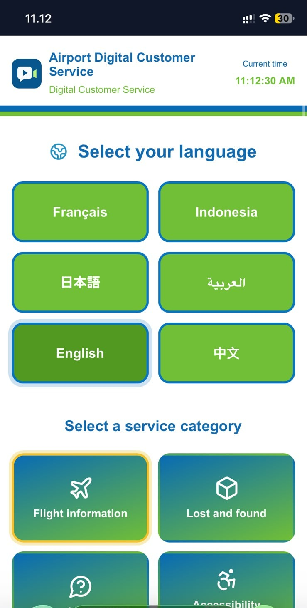
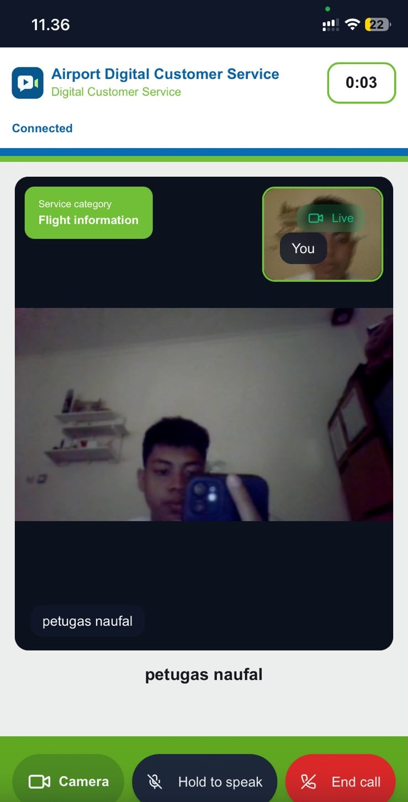
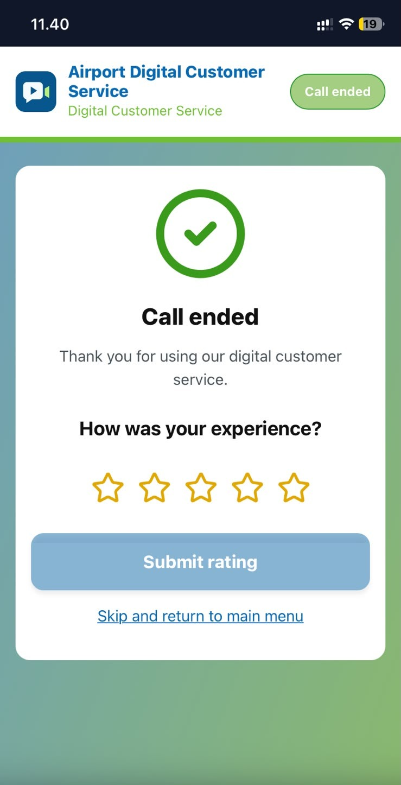

# Airport Digital Customer Service

Simulasi layanan pelanggan bandara melalui panggilan video di jaringan lokal.

## Tentang Proyek

Airport Digital Customer Service adalah proyek portofolio independen yang mendemonstrasikan layanan pelanggan bandara melalui jaringan lokal (LAN). Penumpang meminta bantuan dari ponsel, sementara petugas menangani antrean dan meninjau riwayat panggilan dari Dashboard di laptop.

WebRTC menangani komunikasi audio dan video, Socket.IO mengelola antrean secara real-time, dan SQLite menyimpan riwayat serta hasil layanan. Proyek ini tidak berafiliasi dengan operator bandara atau perusahaan mana pun.

## Fitur Utama

### Penumpang

- Memilih kategori layanan melalui antarmuka yang tersedia dalam bahasa Indonesia, Inggris, Prancis, Jepang, Arab (kanan ke kiri), dan Tionghoa (aksara sederhana).
- Memeriksa kamera, mikrofon, dan koneksi sebelum masuk antrean, melakukan panggilan video satu lawan satu dengan Push-to-Talk, lalu memberi penilaian setelah panggilan.

### Petugas

- Memantau antrean dan menerima atau menolak permintaan melalui **Accept Call** dan **Reject Call**. Waktu tunggu diperbarui setiap detik berdasarkan waktu masuk antrean yang dicatat server, termasuk setelah tampilan berganti atau koneksi tersambung kembali.
- Menyimpan catatan layanan, melihat statistik Dashboard, dan menelusuri **Recent Calls** dengan maksimal lima panggilan per halaman.
- Menyalin nomor referensi permanen `CS-DDMMYY-NNN` melalui **Copy ID**. Nomor urut dimulai dari awal setiap hari menurut zona waktu `Asia/Jakarta`.
- Masuk dengan kode akses yang diverifikasi server dan berganti identitas demo melalui **Logout / Ganti Petugas** setelah panggilan aktif atau yang sudah direservasi selesai.

## Teknologi yang Digunakan

| Bagian | Teknologi |
| --- | --- |
| Antarmuka | React, TypeScript, Vite, Tailwind CSS |
| Backend | Node.js, Express, Socket.IO |
| Media | WebRTC serta API kamera dan mikrofon di peramban |
| Penyimpanan | SQLite melalui `node:sqlite` |
| HTTPS lokal | mkcert dan server pengembangan Vite |

## Arsitektur Sistem

Petugas membuka aplikasi melalui HTTP pada alamat loopback laptop, sedangkan penumpang menggunakan HTTPS pada alamat IP LAN laptop. Vite meneruskan koneksi `/socket.io` dari kedua antarmuka ke backend di `127.0.0.1:3000` untuk antrean dan signaling WebRTC.

WebRTC mengirim audio dan video langsung antara kedua peramban. Antrean aktif disimpan di memori dan dikosongkan ketika backend dimulai ulang. SQLite menyimpan metadata panggilan, catatan, dan penilaian. Aplikasi tidak merekam audio atau video.

```text
Peramban petugas (HTTP loopback)     Peramban penumpang (HTTPS LAN)
                 |                            |
                 +------ Vite /socket.io -----+
                              |
                     Express + Socket.IO
                       |              |
                Antrean di RAM    SQLite lokal

Peramban petugas <------- media WebRTC -------> Peramban penumpang
```

## Struktur Proyek

```text
src/                 Antarmuka, hook WebRTC, dan kamus bahasa penumpang
public/              Logo proyek dan ikon peramban
server/              Express, antrean Socket.IO, dan penyimpanan SQLite
server/tests/        Tes akses lokal, antrean, riwayat, dan bahasa
screenshots/         Tangkapan layar aplikasi
vite.config.ts       HTTP/HTTPS pengembangan dan proksi Socket.IO
.env.example         Templat konfigurasi opsional antarmuka
server/.env.example  Templat konfigurasi backend lokal
```

## Menjalankan Secara Lokal

### Persyaratan

- Node.js 22.20 atau lebih baru pada seri 22, npm, dan mkcert.
- Laptop petugas dan perangkat penumpang dengan peramban yang mendukung WebRTC, kamera, serta mikrofon.
- LAN atau hotspot tepercaya yang memungkinkan kedua perangkat saling terhubung.

### Instalasi Dependensi

Instal dependensi frontend dan backend dari direktori utama proyek.

```sh
npm ci
npm --prefix server ci
```

### HTTPS Lokal dengan mkcert

1. Gunakan CA mkcert yang sudah tersedia di laptop. Jika laptop belum memiliki CA lokal, jalankan `mkcert -install` untuk membuat dan memercayainya.
2. Buat folder `certs/` di direktori utama proyek. Jalankan perintah berikut dan ganti `192.0.2.10` dengan alamat IPv4 LAN laptop saat ini.

   ```sh
   mkcert -cert-file certs/echo-call.pem -key-file certs/echo-call-key.pem localhost 127.0.0.1 ::1 192.0.2.10
   ```

3. Jika iPhone belum memercayai CA tersebut, gunakan `mkcert -CAROOT` untuk menemukan sertifikat publik `rootCA.pem`. Salin hanya sertifikat publik tersebut ke iPhone sebagai berkas `.crt`. Pasang profilnya melalui Pengaturan, lalu aktifkan kepercayaan penuh melalui **Pengaturan → Umum → Mengenai → Pengaturan Kepercayaan Sertifikat**.
4. Buat ulang sertifikat pengembangan jika alamat IPv4 LAN laptop berubah. Simpan private key di laptop.

### Kode Akses Petugas

Untuk salinan proyek baru, salin `server/.env.example` ke `server/.env`. Gunakan perintah berikut jika memakai PowerShell.

```powershell
Copy-Item server/.env.example server/.env
```

Isi `OFFICER_ACCESS_CODE` di `server/.env` dengan nilai acak sepanjang 16–128 karakter. Simpan berkas ini secara privat dan bagikan kode hanya kepada petugas demo yang berwenang.

Untuk konfigurasi standar, pertahankan alamat loopback backend dan biarkan `CLIENT_ORIGIN` serta `VITE_SOCKET_URL` kosong agar koneksi Socket.IO diteruskan melalui proksi Vite.

### Memulai Layanan

Gunakan tiga terminal dari direktori utama proyek. Jalankan satu perintah per terminal, dimulai dari backend.

```sh
npm --prefix server start
npm run dev:https
npm run dev -- --host 127.0.0.1 --port 5175
```

Perintah pertama menjalankan backend di port `3000` dan memuat `server/.env` melalui `--env-file=.env`. Jika port backend berubah, sesuaikan tujuan proksi di `vite.config.ts`.

| Peran | Alamat | Akses awal |
| --- | --- | --- |
| Petugas | [http://localhost:5175/](http://localhost:5175/) | Buka di laptop, lalu masukkan nama demo dan kode akses. |
| Penumpang | `https://<LAPTOP_LAN_IP>:5173/` | Ganti `<LAPTOP_LAN_IP>` dengan alamat IPv4 LAN laptop. Buka dari perangkat penumpang pada jaringan yang sama. |

## Galeri Tampilan Aplikasi

### Antarmuka Petugas

**Panggilan video dan pencatatan layanan oleh petugas**


### Antarmuka Penumpang

1. **Pemilihan bahasa dan kategori layanan**

   

2. **Pemeriksaan kamera, mikrofon, dan koneksi**

   

3. **Panggilan WebRTC melalui iPhone**

   

4. **Penilaian setelah panggilan**

   

## Pengujian

Pada verifikasi dengan Node.js 22.20.0 dan npm 10.9.3, pemeriksaan TypeScript, build produksi, dan enam tes otomatis lulus. Tes mencakup kontrol akses petugas, signaling legacy, siklus antrean, riwayat dan nomor referensi panggilan, persistensi SQLite, serta kamus untuk enam bahasa. Tes signaling menggunakan data simulasi tanpa kamera atau mikrofon fisik.

Untuk menjalankan pemeriksaan dari direktori utama setelah dependensi terpasang, gunakan perintah berikut.

```sh
npm run typecheck
npm run build
npm test
```

## Keamanan dan Batasan Demo

- **Akses jaringan.** Aplikasi ditujukan untuk demo di LAN tepercaya dengan data fiktif. Hindari penggunaan produksi, tunnel publik, dan penerusan port ke internet.
- **Sesi petugas.** Kode akses digunakan bersama dan nama tampilan berfungsi sebagai identitas demo. Sesi berlaku delapan jam, tetap berlaku saat koneksi tersambung kembali, dan dicabut saat logout. Mengubah kode lalu memulai ulang backend membatalkan sesi lama. Petugas yang berwenang dapat melihat riwayat dan statistik bersama. Backend memeriksa origin permintaan polling dan WebSocket secara terpisah dari otorisasi sesi.
- **Data lokal.** SQLite tidak dienkripsi oleh aplikasi. Basis data dan penyimpanan peramban dapat memuat data sesi atau layanan. Simpan `.env`, basis data, log, sertifikat HTTPS lokal, private key, dan data pengguna nyata di luar repositori.
- **Koneksi media.** Setelah dependensi terpasang dan HTTPS dikonfigurasi, dua perangkat yang saling terhubung di LAN dapat melakukan panggilan langsung tanpa internet. STUN publik memerlukan internet, dan aplikasi tidak menggunakan relai TURN. Firewall, isolasi perangkat di LAN, serta izin kamera atau mikrofon dapat memengaruhi panggilan. Pilihan bahasa berlaku untuk antarmuka penumpang, tanpa terjemahan percakapan.
- **Mode legacy.** Signaling `/legacy` dinonaktifkan secara bawaan. Untuk uji panggilan langsung secara lokal, atur `ENABLE_LEGACY=true` di `server/.env`, mulai ulang backend, lalu buka dua tab melalui alamat loopback. Peserta legacy tidak memiliki akses ke antrean atau riwayat panggilan.
